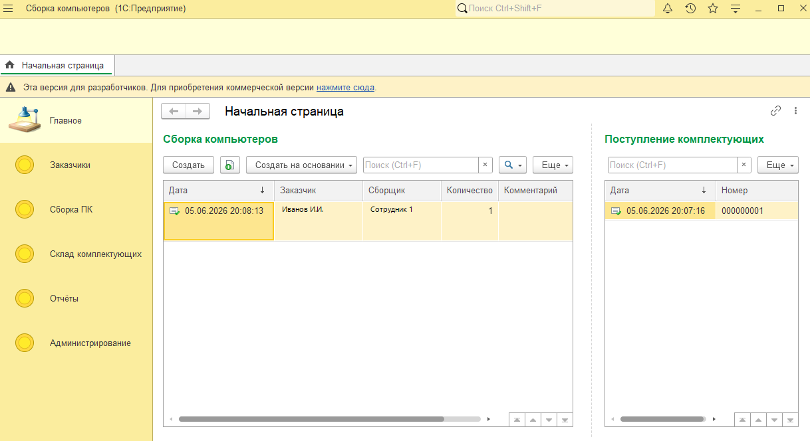
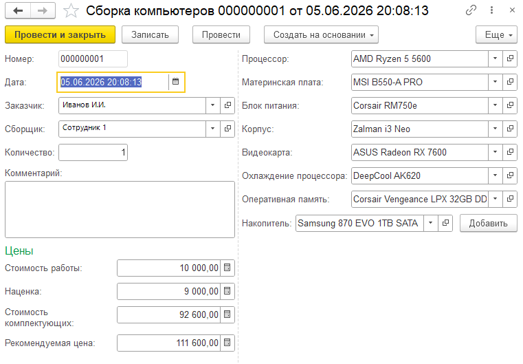
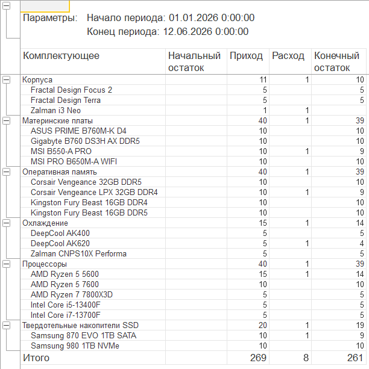
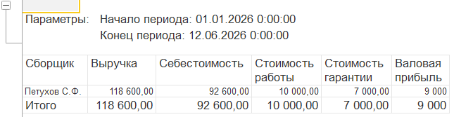
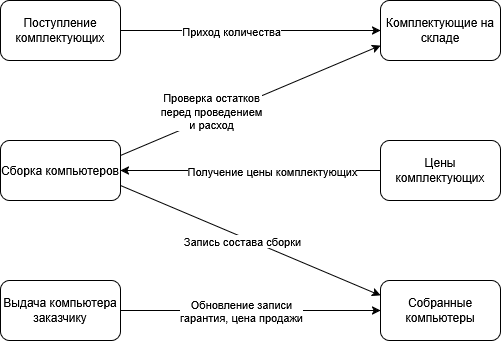

# Сборка компьютеров

[](#требования)
[](#требования)
[](LICENSE)
[](#ограничения)

**Информационная система управления центром сборки персональных компьютеров на 1С:Предприятие.**

Ведёт заказчиков и сотрудников, склад комплектующих, сборку ПК с проверкой совместимости, выдачу готовых машин и отчётность. Это выпускная квалификационная работа (ТУСУР, кафедра АСУ, 2026) — но не набор учебных примеров, а конфигурация с полным циклом: от поступления комплектующих на склад до отчёта по выручке.

<p align="center">
  
</p>

## Что умеет

- **Заказчики** — физлица и юрлица в одном справочнике, с ИНН и автоматическим формированием наименования; лишние поля скрываются в зависимости от типа клиента.
- **Склад комплектующих** — поступление с фиксацией закупочных цен, остатки в реальном времени.
- **Сборка ПК** — документ с выбором комплектующих по слотам: процессор, материнская плата, блок питания, корпус, видеокарта, охлаждение, оперативная память, накопители.
- **Проверка совместимости** — форма документа сверяет пары комплектующих с правилами и не даёт сохранить несовместимую сборку.
- **Контроль остатков** — при проведении сборки система проверяет остатки и не даёт списать больше, чем есть на складе.
- **Себестоимость и цена** — комплектующие считаются по последней цене закупки, сверху наценка и стоимость работы; цена продажи учитывает вариант гарантии.
- **Отчёты** — состояние склада, собранные компьютеры за период, выручка по продажам.

## Скриншоты

<p align="center">
  
</p>
<p align="center"><sub>Форма документа «Сборка компьютеров»: комплектующие по слотам, себестоимость и рекомендуемая цена</sub></p>

<p align="center">
  
  
</p>
<p align="center"><sub>Отчёты на СКД: остатки на складе и выручка по продажам</sub></p>

<p align="center">
  
</p>
<p align="center"><sub>Схема движений документов по регистрам</sub></p>

## Состав конфигурации

**Подсистемы:** Заказчики · Склад комплектующих · Сборка ПК · Отчёты · Администрирование

| Объект | Тип | Назначение |
| --- | --- | --- |
| `Заказчик` | Справочник | Физлицо или юрлицо: наименование, ИНН, контактные данные |
| `Сотрудник` | Справочник | Сборщики и другие сотрудники |
| `Комплектующее` | Справочник | Комплектующие с гибким набором характеристик |
| `Производитель` | Справочник | Производители комплектующих |
| `Должность` | Справочник | Должности сотрудников |
| `ВариантыГарантии` | Справочник | Варианты гарантии и их стоимость |
| `ПравилаСовместимости` | Справочник | Правила проверки совместимости пар комплектующих |
| `ЗначениеСвойств` | Справочник | Допустимые значения свойств комплектующих |
| `СвойстваКомплектующих` | План видов характеристик | Типы характеристик: сокет, форм-фактор, мощность и т. д. |
| `ЗначенияСвойствКомплектующих` | Регистр сведений | Значения характеристик по каждому комплектующему |
| `ЦеныКомплектующих` | Регистр сведений | История закупочных цен |
| `СобранныеКомпьютеры` | Регистр сведений | Состав и состояние собранных ПК |
| `КомплектующиеНаСкладе` | Регистр накопления | Остатки комплектующих на складе |
| `ПоступлениеКомплектующих` | Документ | Приход комплектующих на склад |
| `СборкаКомпьютеров` | Документ | Сборка ПК: расход комплектующих, расчёт себестоимости |
| `ВыдачаКомпьютераЗаказчику` | Документ | Выдача готового ПК, цена продажи, состояние сборки |
| `ТипКлиента`, `ТипКомплектующего`, `ТипСравнения`, `СтатусСборки` | Перечисления | Классификаторы предметной области |
| `СостояниеСклада` | Отчёт | Остатки комплектующих на складе |
| `СобранныеКомпьютерыЗаПериод` | Отчёт | Собранные ПК за выбранный период |
| `ВыручкаПоПродажам` | Отчёт | Выручка по выданным компьютерам |
| `Сервисный` | Общий модуль | Совместимость, цены, себестоимость, гарантия |

## Требования

| | |
| --- | --- |
| Платформа | 1С:Предприятие 8.5.1 и новее |
| Режим совместимости | 8.5.1 |
| Режим запуска | Управляемое приложение |
| Интерфейс | Такси |
| Внешние компоненты | Не используются |

## Как развернуть

1. Создайте пустую информационную базу (файловую достаточно).
2. В Конфигураторе: **Конфигурация → Открыть конфигурацию из файлов** → укажите каталог `src`.
3. **Конфигурация → Обновить конфигурацию базы данных** (F7), примите изменения.
4. Запустите **1С:Предприятие**.

Если платформа ниже 8.5.1, поднимите версию платформы или понизьте режим совместимости перед загрузкой.

## Что демонстрирует код

- **Гибкие характеристики вместо жёстких реквизитов** — план видов характеристик плюс регистр сведений: добавить новый тип характеристики можно без изменения структуры справочника.
- **Проверка совместимости** — общий модуль `Сервисный` сравнивает пары комплектующих по правилам, форма документа вызывает проверку перед записью и показывает ошибку.
- **Контроль остатков при проведении** — запрос к остаткам регистра накопления, отказ при нехватке комплектующих.
- **Расчёт себестоимости** — по последней цене закупки, с наценкой и стоимостью работы.
- **Расчёт цены продажи** — с учётом выбранного варианта гарантии.
- **Три отчёта на СКД** — с параметрами и настройками, без ручного вывода таблиц.
- **Управляемые формы** — обработчики выбора и изменения для каждого слота сборки, автоподстановка цены при вводе.

## Структура репозитория

```
1c-pc-assembly/
├─ README.md
├─ LICENSE
├─ .gitignore
├─ docs/
│  └─ screenshots/          # скриншоты интерфейса
└─ src/                     # выгрузка конфигурации в файлы
   ├─ Configuration.xml
   ├─ ConfigDumpInfo.xml
   ├─ Catalogs/
   ├─ Documents/
   ├─ InformationRegisters/
   ├─ AccumulationRegisters/
   ├─ ChartsOfCharacteristicTypes/
   ├─ Enums/
   ├─ Reports/
   ├─ CommonModules/
   └─ Subsystems/
```

## Ограничения

Учебный проект, а не готовая конфигурация для внедрения:

- роли и права доступа не настроены — разграничения нет;
- нет обмена с другими системами и загрузки из файлов;
- нет печатных форм (счёт, гарантийный талон);
- данные для демонстрации вводятся вручную, тестовой базы в комплекте нет.

## Лицензия

Код конфигурации — [MIT](LICENSE). Платформа 1С:Предприятие и её компоненты — собственность фирмы «1С», здесь распространяется только код автора.

---

<details>
<summary><b>🇬🇧 English</b></summary>

<br>

**A 1C:Enterprise configuration for managing a custom PC assembly business.**

It covers the full cycle: customers and employees, component stock with purchase prices, PC assembly with compatibility checks and stock control, handover to the customer, and reporting.

- Flexible component characteristics via a chart of characteristic types and an information register
- Compatibility rules checked in a common module before a build is posted
- Cost calculation from the latest purchase price, plus markup and assembly labour
- Sale price including the selected warranty option
- Three data composition system (SKD) reports: stock, assembled PCs, revenue

Built as a bachelor's thesis at TUSUR (2026), platform 1C:Enterprise 8.5.1, managed application, Taxi interface. To run: create an empty infobase, open the configuration from files in `src/`, update the database configuration, and start the application.

Code is MIT licensed; the 1C:Enterprise platform is proprietary.

</details>
